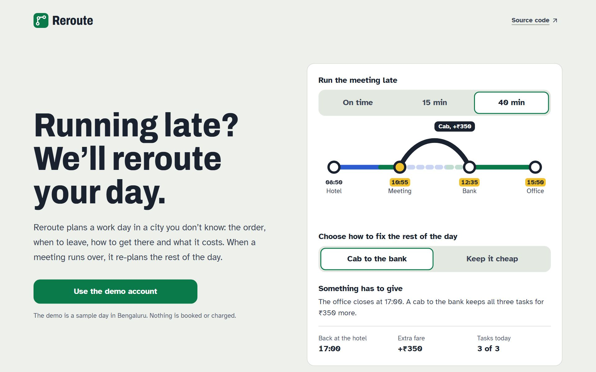
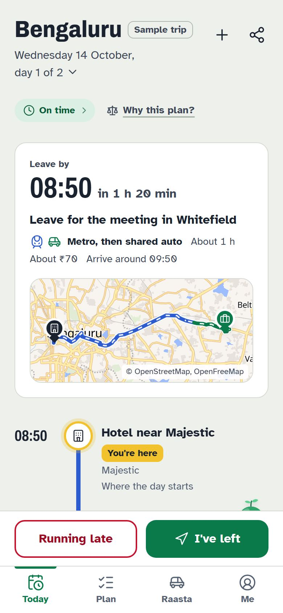
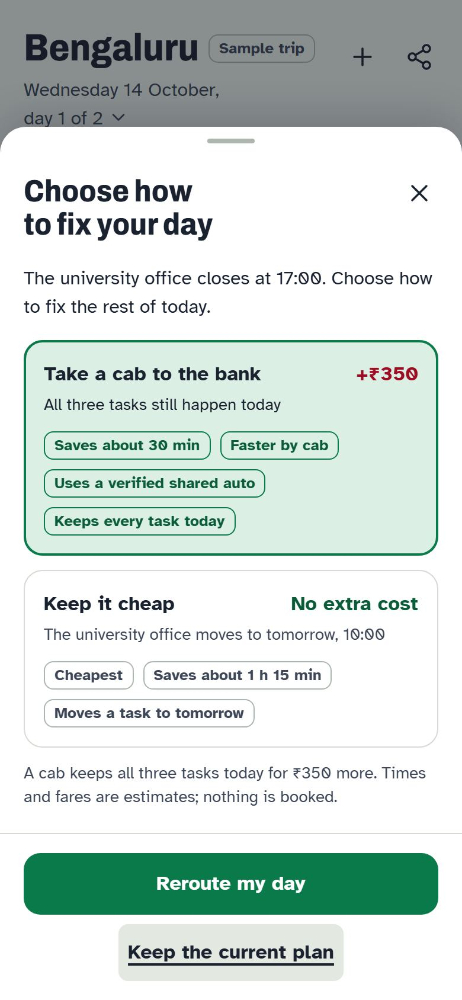
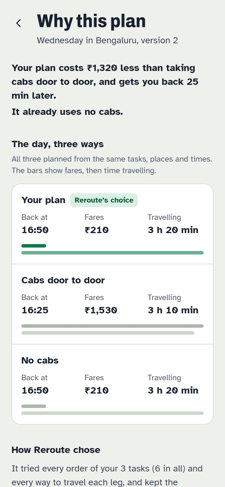
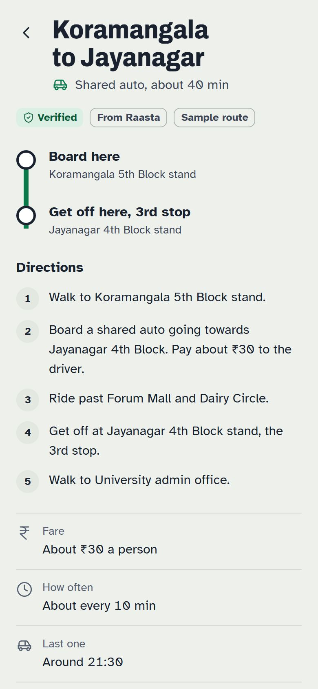
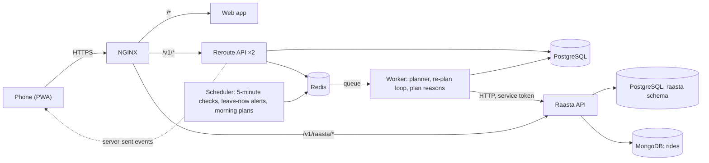

# Reroute

[](https://github.com/Panther465/Reroute/actions/workflows/ci.yml)

*Running late? We'll reroute your day.*

<picture>
  <source media="(prefers-color-scheme: dark)" srcset="docs/images/landing-dark.jpg">
  
</picture>

Reroute is a travel companion for work trips to an unfamiliar Indian city. You enter your tasks once: a meeting at 10:00, a bank that's open till 16:00, an office that closes at 17:00. Reroute plans the day (the order, when to leave, how to travel and what each leg costs) and follows it with you. When you run late, it re-plans the rest of the day: if everything still fits it shifts the times and tells you; if something has to give, it changes nothing and offers two or three explained options.

**Raasta**, the second module, is a crowdsourced, moderated map of shared-auto, e-rickshaw and tempo routes: the stands, the fare, how often they come and when the last one leaves. Reroute uses verified Raasta routes for local legs.

Every travel time and fare is an estimate. All demo data is sample data.

<table>
  <tr>
    <td width="25%"><picture><source media="(prefers-color-scheme: dark)" srcset="frontend/public/landing/today-dark.jpg"></picture></td>
    <td width="25%"><picture><source media="(prefers-color-scheme: dark)" srcset="docs/images/options-dark.jpg"></picture></td>
    <td width="25%"><picture><source media="(prefers-color-scheme: dark)" srcset="frontend/public/landing/why-dark.jpg"></picture></td>
    <td width="25%"><picture><source media="(prefers-color-scheme: dark)" srcset="frontend/public/landing/raasta-dark.jpg"></picture></td>
  </tr>
  <tr>
    <td>The day as a transit line</td>
    <td>40 minutes late: you choose</td>
    <td>Why this plan?</td>
    <td>A verified shared auto</td>
  </tr>
</table>

## What to look at

- **An exact planner, pinned by a golden test.** The planner (`backend/app/services/planner/`) is a pure function: tasks, opening hours, fixed times and travel options in, a plan out, with no clock, network or database. It searches every order up to eight tasks with branch and bound, and `backend/tests/planner/test_golden.py` holds the demo day to the minute: 08:50, 10:00, 12:25, 15:40, 16:50.
- **Re-planning that knows when to ask.** Fifteen minutes late, the later stops shift by themselves and Undo brings the old plan back. Forty minutes late, nothing changes until you pick one of two or three explained options: a cab to the bank for ₹350 more, or the office moved to tomorrow at 10:00.
- **Someone else's meeting is never moved.** A fixed time is a rule the planner can't break. If you can't make it in time, Reroute offers to **go anyway**: the meeting stays at 10:00, the rest of the day is planned from when you really arrive, and **Tell them** writes the message ("I'm running about 25 minutes late… I'll be there around 10:25").
- **It shows its working.** "Why this plan?" sets the chosen day beside the same tasks planned cab-only and with no cab, lists every way Reroute knew for each leg with what it would have changed, and says whether the order search was exact. The worker works this out with the plan and stores it; the API only reads it back.
- **Never plans inside a request.** The API saves and queues; an RQ worker plans. Plans are immutable versions, so Undo reactivates an earlier one, and a scheduler checks every trip each five minutes, raises leave-now alerts and plans each morning of a multi-day trip from 06:00 local time.
- **Built for a bad connection.** An installable PWA: the day is cached, check-ins made offline are queued and replayed with idempotency keys, and live changes arrive over server-sent events with a watchdog that reconnects.
- **Real accounts, met by Rico.** Create an account with an email and a password (stored as a salted scrypt hash) or Google; a new account meets Rico full screen, which sets up the first trip by chatting and plans it.
- **A wallet, flights and connected services, all simulated.** Cab, train and flight bookings through invented partners (RideNow, AutoGo, ZipBike, RailGo, SkyHop) are paid from a wallet of pretend money, and a short balance says how much to add.
- **Talk to Rico.** Say "I'm 20 minutes late" and Running late opens with 20 filled in; "done", "I've left" and "what's next" work too. Plain patterns, no AI, and nothing changes without your last tap.
- **Rico in 3D, lips in time with its voice.** On devices that draw 3D well, Rico is a soft plush 3D sprout (three.js, built from shapes in code: fuzzy fur, felt cheeks, a stitched face) that breathes, blinks, follows your pointer and hops as it speaks. Its mouth takes the shape of each sound it says, timed from the voice service's word timings and the clip's loudness; elsewhere the flat Rico's mouth does the same. Lines play one after another, never cutting each other off.
- **Rico does it for you** (with the AI helper and a Gemini key). Ask for several things at once ("skip the university office, book a cab to the bank and go dark") and Rico reads your day, the rides and your wallet, then puts every change on one card: *Rico will do 3 things*. Nothing changes until you tap **Do all**; each step then shows how it went, and **Undo** takes the card back. Rico works through the app's own API, signed in as you, so it can do exactly what you can and no more.
- **A second service with its own rules.** Raasta trims the ends of every recorded ride for privacy, verifies a route only with a moderator or two different riders, lets routes go stale, and serves Reroute over HTTP with a service token: the database roles make reading its tables from Reroute impossible.
- **Accessible in both themes.** Playwright runs axe on every screen at phone and desktop sizes, in light and in dark; targets are at least 48 px, and motion follows the reduced-motion setting.

Every choice that departs from the briefs is logged with its reason in [docs/decisions.md](docs/decisions.md).

## Quick start

You need Git and Docker Desktop.

```bash
git clone https://github.com/Panther465/Reroute.git
cd Reroute
docker compose up --build
```

Open **https://localhost**, accept the local certificate, and choose **Create account**: Rico meets you and sets up your first trip.

To try the prepared demo day (and its **Simulate** panel), add `DEMO_LOGIN=true` to the `.env` file at the repository root and run `docker compose up -d`; **Use the demo account** then appears under the sign-in options.

If ports are taken on your machine, the stack stays out of the way: PostgreSQL, Redis and MongoDB are published on 55432, 56379 and 57017, and plain HTTP on 8080. Change any of them with `POSTGRES_HOST_PORT`, `REDIS_HOST_PORT`, `MONGO_HOST_PORT`, `HTTP_PORT` or `HTTPS_PORT`. Everything listens on 127.0.0.1 only; set `BIND_ADDR=0.0.0.0` to try the app from a phone on the same network. Browsers won't install the offline service worker over an untrusted certificate; to try offline mode locally, trust the certificate (for example with [mkcert](https://github.com/FiloSottile/mkcert), placed at `/etc/nginx/certs/localhost.{crt,key}` in the `certs` volume). The demo trip is Bengaluru, Wednesday 14 October 2026, on a simulated clock.

Try the golden path:

1. **Plan** → **Plan my day**. The plan leaves the hotel at 08:50; the meeting is 10:00 to 11:00, the bank 12:25, the university office 15:40, back at the hotel 16:50.
2. Open the **Simulate** panel, set the time to 10:55, then **Running late** → **About 15 min**. Everything still fits, so Reroute shifts the later stops (12:40, 15:55, 17:05) without asking.
3. Undo it, then report **About 40 min**. Now something must give: **Take a cab to the bank** (+₹350, saves 30 min) or **Keep it cheap** (the office moves to tomorrow at 10:00). Choose one, then Undo.
4. On Today, tap **Why this plan?** to see the day planned three ways and every option for each leg.
5. Tap Rico on the Now line, then **Talk to Rico**, and say "what's next" (Chrome or Edge; the browser asks for the microphone once).
6. **Share** your trip and open the link in a private window: family see your stops and progress, never your exact location.

## How it fits together



- The **planner** is a pure function (`backend/app/services/planner/`): inputs in, plan out, no clock, network or database. Up to eight tasks the search is exact.
- The **API never plans inside a request**: it saves, enqueues, and the worker plans. Plans are immutable versions; Undo reactivates an earlier one.
- **Reroute reaches Raasta only over HTTP** through the transit adapter. The database roles make reading Raasta's tables impossible.
- Live updates go to the phone as server-sent events.

## Repository

| Path | What |
|---|---|
| `backend/` | Reroute API, worker and scheduler (FastAPI, SQLAlchemy, RQ) |
| `raasta/` | Raasta API (FastAPI, PostGIS, MongoDB) |
| `frontend/` | The web app (React, Vite, TypeScript, PWA) |
| `shared/contracts/` | Generated OpenAPI files: the contract |
| `examples/bengaluru/` | Sample demo trip, travel times and Raasta routes |
| `postman/` | API collection with response examples |
| `tests/load/` | k6 load test |
| `infra/` | NGINX, PostgreSQL roles, OSRM preparation |
| `docs/` | [API guide](docs/api-guide.md), [testing guide](docs/testing-guide.md), [decisions](docs/decisions.md), [data and privacy](docs/data-and-privacy.md), [known limits](docs/known-limits.md), [briefs](docs/briefs/) |

## Working outside Docker

Node.js 22 (LTS) and Python 3.12 are only needed here.

```bash
# Databases only (published on 55432, 56379 and 57017 so they don't clash with local installs)
docker compose up -d postgres redis mongo

# Reroute API (http://localhost:8000/v1/docs)
cd backend && python -m venv .venv && . .venv/bin/activate   # Windows: .venv\Scripts\activate
pip install -e ".[dev]" && cp .env.example .env
alembic upgrade head && python -m app.seed
uvicorn app.main:app --reload            # and in other shells: rq worker planning; python -m app.workers.scheduler

# Raasta API (http://localhost:8001/v1/raasta/docs)
cd raasta && pip install -e ".[dev]" && cp .env.example .env && alembic upgrade head && python -m app.seed && uvicorn app.main:app --port 8001

# Web app (http://localhost:5173)
cd frontend && pnpm install && pnpm dev
```

## Tests

| Suite | Size | Command |
|---|---|---|
| Reroute API and planner | 232 tests (the API flow tests need `TEST_DATABASE_URL` pointing at PostGIS) | `cd backend && pytest` |
| Raasta | 107 tests | `cd raasta && pytest` |
| Web app | 132 tests | `cd frontend && pnpm test` |
| The demo day over HTTP | 32 requests, 54 assertions | `npx newman run postman/reroute.postman_collection.json --insecure` |
| End to end with axe | 52 tests, phone and desktop | `cd frontend && E2E_BASE_URL=https://localhost pnpm e2e` |
| Load | 500 virtual users, 95% under 500 ms | `k6 run tests/load/k6.js` |

CI runs all of them except the load test, which runs on demand, and fails if either API's OpenAPI file drifts from `shared/contracts/`.

To test by hand, feature by feature (and with a real Google account), follow [docs/testing-guide.md](docs/testing-guide.md).

## Configuration

Every setting is an environment variable documented in `backend/.env.example`, `raasta/.env.example` and `frontend/.env.example`. No secret is committed or sent to the browser. `DEMO_LOGIN` (off unless set) turns on the demo account; `SIMULATED_SERVICES` (on by default, off in `docker-compose.prod.yml`) turns on the simulated bookings, wallet and connected partners for every account. `DEMO_LOGIN=true` is refused when `APP_ENV=production`, and so are development values of `JWT_SECRET` and `RAASTA_SERVICE_TOKEN`.

For a deployment, `docker compose -f docker-compose.yml -f docker-compose.prod.yml up -d --build` runs everything in production mode without the demo login; Compose refuses to start until every secret it names is set.

## Team

| Owner | Area |
|---|---|
| Ankit | Backend and the agentic flow: the APIs, planner, re-plan loop and worker |
| Diksha Sharma | Databases and AI: schemas, migrations, PostGIS and MongoDB, Redis, seed and Raasta data, the optional AI helper |
| Trish | Frontend: the React PWA, following the UI brief |
| Lovish | Testing and deployment: pytest, Postman and Newman, k6, Playwright with axe, Docker, NGINX, CI |
